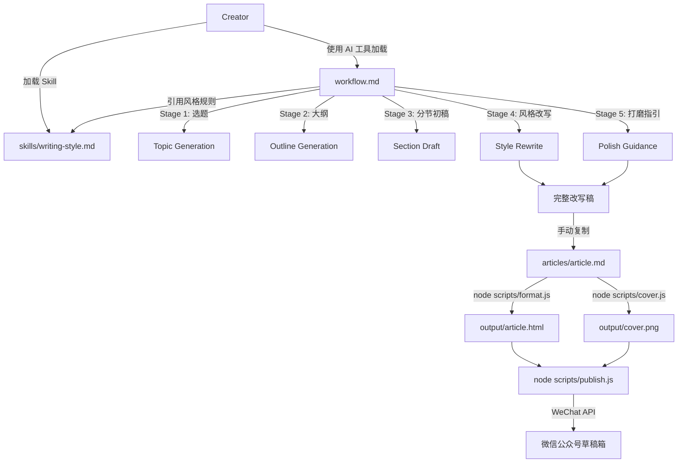

# Design Document: 微信公众号 AI 写作工作流

## Overview

本设计文档描述微信公众号 AI 写作工作流（WeChat Writing Workflow）的技术架构与组件设计。该系统本质上是一套**静态文件集合 + 自动化脚本**，而非传统意义上的 Web 应用程序。

核心组成：
- **工作流指令文件**（`workflow.md`）：定义五步写作流程的 AI 提示词模板
- **写作风格 Skill 文件**（`skills/writing-style.md`）：定义 Creator 的个人写作风格规范
- **自动化脚本**（`scripts/`）：排版、封面生成、发布至微信草稿箱
- **模板文件**（`templates/`）：HTML 排版模板和封面模板

AI 交互层直接通过支持 Kiro Workflow/Skill 的 AI 工具（如 Kiro IDE）运行，无需独立后端服务。排版和发布脚本以 Node.js 命令行工具形式运行。

---

## Architecture



### 关键设计决策

1. **无中间层架构**：AI 交互直接在 AI 工具中完成，不需要 Chrome Extension 作为中间层。workflow.md 即为完整的交互规范。
2. **松耦合组件**：各脚本之间通过约定的文件路径通信，不存在直接函数调用依赖。
3. **Node.js 脚本**：选用 Node.js 作为脚本运行时，因目标用户（互联网职场）普遍已有 Node.js 环境，且微信公众号 API SDK 生态完善。
4. **本地文件优先**：所有中间产物保存在本地，推送失败时不丢失数据。

---

## Components and Interfaces

### 1. workflow.md（工作流主文件）

**职责**：定义五个写作阶段的 AI 提示词模板，是整个工作流的核心指令中枢。

**文件结构**：
```
# 微信公众号写作工作流

## 快速参考索引
- Stage 1: 选题生成 → 本文件 §1
- Stage 2: 大纲生成 → 本文件 §2
- Stage 3: 分节初稿 → 本文件 §3
- Stage 4: 风格改写 → 本文件 §4（依赖 skills/writing-style.md）
- Stage 5: 人工打磨指引 → 本文件 §5

## Stage 1: 选题生成
输入参数: {identity}, {topic_direction}
预期输出: 5 个选题方向，每项含标题 + 一句话说明

[提示词模板]

## Stage 2: 大纲生成
输入参数: {confirmed_topic}
预期输出: 6-8 节大纲，每节含标题 + 核心内容说明

[提示词模板]

## Stage 3: 分节初稿
输入参数: {outline}, {section_index}, {previous_section_summary}
预期输出: 单节 Draft，200-300 字

[提示词模板]

## Stage 4: 风格改写
输入参数: {full_draft}
预期输出: 改写后完整文章

[提示词模板，引用 Style_Guide]

## Stage 5: 人工打磨指引
输入参数: {rewritten_article}
预期输出: 打磨检查清单 + 标注位置 + 开头评分

[提示词模板]
```

**接口规范**：
- 每个 Stage 节必须注明：`输入参数`、`预期输出格式`
- Stage 4 必须在提示词中显式引用 `writing-style.md` 中的风格规则

---

### 2. skills/writing-style.md（写作风格 Skill）

**职责**：定义 Creator 个人写作风格的可复用规范，供 Stage 4 改写时加载。

**文件结构**：
```
# 写作风格 Skill

## 公众号基本信息
- 账号名称: [xxx]
- 目标读者: [xxx]
- 内容方向: [xxx]

## 写作模式

### 正常模式
[规则列表]

### 放飞模式
[规则列表]

## 当前激活模式
[正常模式 / 放飞模式]

## 禁用词列表
- 此外
- 综上所述
- 希望对你有帮助
- 总体而言
- [更多...]
```

**接口规范**：
- 必须包含"公众号基本信息"、"写作模式"（至少两种）、"禁用词列表"三个顶级节
- "当前激活模式"字段用于 Creator 切换模式时修改

---

### 3. scripts/format.js（排版脚本）

**职责**：将 Markdown 文章应用至 HTML 排版模板，生成符合微信公众号格式的 HTML 文件。

**命令行接口**：
```bash
node scripts/format.js [article_path] [--output output_path]
```

**处理流程**：


**错误处理**：文件不存在、模板解析失败时，输出包含错误原因和建议操作的错误信息并以非零状态码退出。

---

### 4. scripts/cover.js（封面生成脚本）

**职责**：基于封面模板和文章标题生成封面图文件。

**命令行接口**：
```bash
node scripts/cover.js [title] [--output output_path]
```

**依赖**：使用 `puppeteer` 或 `node-canvas` 进行图片渲染（取决于模板复杂度）。

---

### 5. scripts/publish.js（发布脚本）

**职责**：将排版后的 HTML 文件和封面图推送至微信公众号草稿箱。

**命令行接口**：
```bash
node scripts/publish.js [--article output/article.html] [--cover output/cover.png]
```

**环境配置**（通过 `.env` 文件）：
```
WECHAT_APP_ID=xxx
WECHAT_APP_SECRET=xxx
```

**处理流程**：


**错误处理**：API Token 过期或网络错误时，输出错误原因并保留本地文件。推送成功后输出草稿箱链接或成功确认信息。

---

### 6. templates/（模板文件）

- **`format-template.html`**：微信公众号文章排版 HTML 模板，包含内容占位符（`{{title}}`、`{{content}}`、`{{author}}`）
- **`cover-template.html`**：封面图生成 HTML 模板，包含标题占位符

---

## Data Models

### TopicItem（选题项）

```typescript
interface TopicItem {
  index: number;          // 1-5
  title: string;          // 选题标题
  description: string;    // 一句话说明（切入点 + 读者收益）
  narrativeType: 'problem-driven' | 'methodology' | 'story' | 'opinion' | 'tool';
}
```

### Outline（大纲）

```typescript
interface Outline {
  topic: string;           // 确认的选题
  sections: Section[];     // 6-8 个节
}

interface SectionMeta {
  index: number;           // 节序号（1-based）
  title: string;           // 节标题
  summary: string;         // 核心内容一句话说明
  type: 'intro' | 'method' | 'interaction' | 'general';
}
```

### Draft（节草稿）

```typescript
interface Draft {
  sectionIndex: number;    // 对应节序号
  content: string;         // 正文内容，200-300 字
  wordCount: number;       // 实际字数
}
```

### StyleGuide（写作风格规范）

```typescript
interface StyleGuide {
  accountName: string;
  targetAudience: string;
  contentDirection: string;
  modes: {
    normal: StyleMode;
    freestyle: StyleMode;
  };
  activeMode: 'normal' | 'freestyle';
  bannedWords: string[];
}

interface StyleMode {
  name: string;
  description: string;
  rules: string[];
}
```

### PublishConfig（发布配置）

```typescript
interface PublishConfig {
  appId: string;          // 微信公众号 AppID（从环境变量读取）
  appSecret: string;      // 微信公众号 AppSecret（从环境变量读取）
  articlePath: string;    // 排版后 HTML 文件路径
  coverPath: string;      // 封面图文件路径
}
```

### ScriptResult（脚本执行结果）

```typescript
interface ScriptResult {
  success: boolean;
  message: string;         // 成功确认信息或错误原因
  outputPath?: string;     // 成功时的输出文件路径
  draftUrl?: string;       // 发布成功时的草稿箱链接
}
```

---

